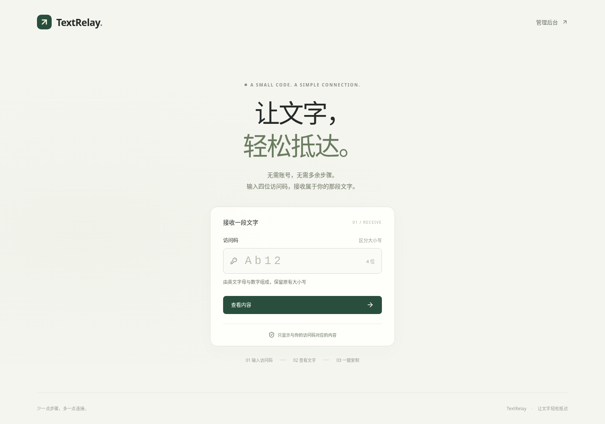
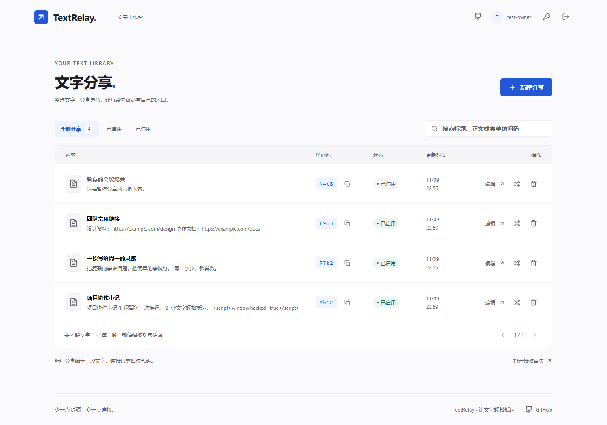

# TextRelay

[在线使用](https://1.14.186.80/) · [管理后台](https://1.14.186.80/manage) · [GitHub 仓库](https://github.com/Quashy/text-relay)

**让文字，轻松抵达。**

TextRelay 是一个轻巧的纯文本分享工具。给同事一个四位访问码，他们就能在同一个首页打开文字、保留原有格式并一键复制，无需注册账号。

适合团队常用说明、协作小记、临时指引和需要原样传递的文字。每个人有独立的分享工作台，最高管理员负责管理账号。



## 接收一段文字

1. 打开 TextRelay 首页。
2. 输入收到的 **四位访问码**，例如 `Ab12`。
3. 点击「查看内容」，然后「复制全文」。

访问码由英文字母和数字组成，**区分大小写**。`Ab12` 与 `ab12` 是不同的访问码。复制只包含原正文，不附带标题、访问码或额外说明。浏览器无法自动复制时，可手动选择并复制。

## 管理你的分享

在首页右上角进入「管理后台」，登录管理员账号后：

- 新建分享：写好标题和正文，自定义访问码或自动生成。
- 查找内容：搜索标题、正文关键词或完整访问码，按状态筛选。
- 编辑文字：随时更新正文；标题仅供后台整理。
- 暂停与恢复：停用后访客无法继续读取，原码仍被保留。
- 换码与删除：旧码立即释放，可以重新使用。

**旧码重新分配后，曾经知道旧码的人可能读到新内容。** 知道当前有效访问码的人均可查看正文。TextRelay 面向非敏感文字分享；停用、删除或换码不能撤回他人已显示或复制的文字。



## 在自己的电脑运行

需要 Node.js 24。

```sh
npm ci
cp .env.example .env
npm run build
npm run admin -- init
npm start
```

打开 http://localhost:3000 。初始化命令会交互询问账号和密码，不提供默认账号。密码至少 6 个字符；命令行中不需要填写密码。

[开发与测试](docs/development.md) · [自部署](docs/deployment.md) · [备份与恢复](docs/backup-restore.md) · [验收记录](docs/acceptance.md)

## 常见问题

**支持哪些内容？**

只支持纯文本，每条最多 100 KiB，换行、空格和缩进均保留。HTML、Markdown 均按文字显示。第一版不包含附件、多人管理或自动过期。

**忘记密码怎么办？**

在运行机器的交互终端执行 `npm run admin -- reset`。分享内容不会被清空，旧登录会话会失效。

**访问码为什么不可用？**

请核对大小写及四位字符。内容也可能被管理员停用、删除或更换了访问码。连续尝试过快时稍等片刻。

**开源是否代表分享内容公开？**

开源的是应用代码。运行数据保存在你自己的 SQLite 数据库，不进入 Git 仓库。

## 开源与贡献

MIT 许可证。欢迎提交可复现的问题和范围清楚的改进，详见 [贡献指南](CONTRIBUTING.md)。界面截图均为虚构示例。

前端使用 React 19，后端为 TypeScript + Fastify + SQLite，一个 Node 应用提供页面与 API。部署、备份与 CI 保持简单，详见相应文档。

## 多用户与账号管理

- 原 quashy 账号是唯一最高管理员，登录后通过「用户管理」创建、查看、编辑和删除普通用户。
- 所有用户（包括最高管理员）只能在后台查看和管理自己的分享；公开访问码入口仍按原规则工作。
- 修改用户的用户名或密码后，该用户须重新登录。删除用户会同时删除该用户全部分享与会话，页面会明确确认；最高管理员不可删除或更名。
- 旧账号、密码和分享自动安全迁移，原分享归 quashy，访问码和正文保留；升级后需要重新登录。
- 尚未预设任何同事账号。请自行在用户管理中填写真实用户名和初始密码。

涉及数据库升级时，请先阅读 [多用户迁移与恢复说明](docs/multi-user-migration.md)。
