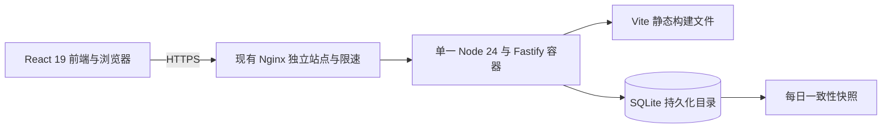

<!-- 技术方案原页的只读快照；原页保留。快照日期：2026-11-09 -->
来源：https://chatgpt.com/space/page_f4b7f6d0f238819191614f1af195fa3b

状态：TextRelay TRD v0.4 初稿。用户已明确采用 TypeScript + SQLite；建议前端 React 19 + Vite，后端 Fastify，生产环境运行一个 Node 应用容器。目标为非敏感纯文本分享工具，保持简单够用、低维护。项目及仓库建议名 TextRelay / text-relay，命名由用户授权决定。删除及换码后的旧码立即可复用，复用后果已获接受。自研部署腾讯服务器、GitHub 开源和 push 后 CI/CD 上线均在范围内；当前只完成方案，不开发、不创建仓库、不上传或改动服务器。

# 已确认的产品边界

所有同事使用同一个首页，输入恰好四位的访问码后查看对应纯文本并一键复制，无需账号。访问码字符集为 A–Z、a–z、0–9，区分大小写；可以手动设置或随机生成，现存内容之间不得重复。停用内容仍占用访问码；删除内容后旧码可重新分配。

唯一管理员登录后可按标题、正文和访问码搜索，创建、查看、编辑、删除内容，查看完整访问码，停用或恢复分享，以及换码。第一版不包含附件、Markdown、多人管理、有效期或次数限制。

用户已确认分享内容不含敏感信息。知道当前有效访问码的人均可查看；访客无需注册。停用、换码和删除影响之后的读取，已经显示或复制的文本由访问者自行保留。该访问边界已经确定。

# 建议架构与选型

建议采用 TypeScript 同源单体：前端 React 19 与 Vite，后端 Fastify 5 与 better-sqlite3，运行时选 Node.js 24 LTS 的受支持补丁版本。Fastify 提供路由、JSON Schema 请求校验和可直接注入请求的测试能力，适合这里的小型 API；@fastify/static 提供构建后的前端文件。生产环境只有一个 Node 进程和一个容器，统一域名及端口，不额外运行前端开发服务器或 SSR 服务。[Fastify 支持策略](https://fastify.dev/docs/latest/Reference/LTS/)、[静态文件插件](https://github.com/fastify/fastify-static)、[Node.js 发布状态](https://nodejs.org/en/about/previous-releases)

架构约束是简单够用、低维护：一个业务应用、一个 SQLite 文件、一个发布工作流，复用现有 HTTPS 入口。前后端共享 TypeScript 类型，但接口必须在服务端用 JSON Schema 校验，不能把编译期类型当作运行时验证。数据访问直接使用参数化 SQL 和少量版本化 SQL 迁移，不引入 ORM、数据库服务或队列。目录采用 src/server、src/client、src/shared；根目录一个 package.json 与锁文件，统一提供 dev、typecheck、test、build、start、backup、admin 等命令。

现有 Nginx 负责 HTTPS 与入口限速，Fastify 仅信任确认的代理。Vite 在开发时把 /api 代理到本地 Fastify；生产时将静态构建产物放入应用镜像，由同一个 Fastify 服务页面与 /api。SPA 回退只处理已知页面路径，不能把未知 API 错误返回为 index.html。数据库位于独立持久化目录，使用单进程、单业务连接；不放进镜像、前端静态目录或网络共享盘。

容量假设：活跃内容不超过 1,000 条，累计不超过 10,000 条，单条正文最多 100 KiB UTF-8；多数请求为读取，管理员写入很少。性能验收建议为缓存资源加载完成后，正常限速内 5 个并发读取的服务端响应 P95 不超过 500 ms。此处不是现有服务器能力结论，须在实际规格确定后验证。

# 页面与服务端接口

访客首页仅加载空白输入界面和静态资源，不预加载内容、标题或码表。输入框关闭自动大写与拼写纠正；服务端去除访问码首尾空白后按 ASCII 正则 `^[A-Za-z0-9]{4}$` 校验，保留大小写，不对正文做去空白操作。

| 路径与方法 | 权限 | 行为 |
| --- | --- | --- |
| GET / | 公开 | 前端访客验码页 |
| POST /api/share/resolve | 公开，限速 | 请求体传 code；成功只返回该条正文和必要字段 |
| GET /manage/login | 公开 | 前端登录页 |
| POST /api/auth/login | 公开，限速及来源校验 | 验证唯一管理员并建立新会话 |
| GET /api/auth/session | 已登录 | 返回管理员状态与过期信息，不返回会话凭据 |
| POST /api/auth/logout | 已登录，来源校验 | 删除当前会话并清 Cookie |
| POST /api/auth/password | 已登录，来源校验 | 校验旧密码、设置新密码并使所有会话失效 |
| GET /manage/ | 页面外壳公开，数据鉴权 | 前端管理界面；API 决定数据访问权 |
| GET /api/admin/shares | 管理员 | 分页列表，默认每页 20 条 |
| POST /api/admin/shares/search | 管理员，来源校验 | 请求体搜索；标题和正文子串匹配，访问码精确且区分大小写 |
| POST /api/admin/shares | 管理员，来源校验 | 创建内容；手动码或随机模式 |
| GET /api/admin/shares/{id} | 管理员 | 查看正文、状态与访问码 |
| PATCH /api/admin/shares/{id} | 管理员，来源校验 | 修改标题、正文或启停状态 |
| POST /api/admin/shares/{id}/rotate-code | 管理员，来源校验 | 手动设置或随机换码 |
| DELETE /api/admin/shares/{id} | 管理员，来源校验 | 删除并释放访问码 |

所有管理接口逐个执行服务端鉴权，不能依赖页面隐藏按钮。访客没有列表、搜索、按 ID 读取或修改接口。访问码不进入路径、查询参数、分析埋点或访问日志。后台搜索同样通过 POST 请求体传条件，避免访问码或正文关键词留在 URL 和代理日志中。

公开验码接口：成功 200；不存在、停用、已删除统一返回 404 和“访问码无效或内容不可用”；格式错误 400；限速 429 并带 Retry-After；服务异常 503 不暴露内部细节。不得另设公开的“访问码是否存在”接口。

React 以普通文本节点渲染正文，使用 white-space: pre-wrap 保留换行，不使用 dangerouslySetInnerHTML 或 HTML 解析。复制按钮复制原正文，不添加标题或说明；失败时可手动选中复制。访客标题是否展示由 PRD 决定，默认只作为后台字段。

# 数据模型与访问码存储

| 实体 | 主要字段 | 约束 |
| --- | --- | --- |
| Share | UUID id、title、body、code、enabled、version、created_at、updated_at | code 为四位 ASCII 文本，BINARY 排序规则与唯一索引；enabled 为布尔；version 防覆盖 |
| Admin | 固定单条 id、username、password_hash、updated_at | 密码哈希包含 scrypt 参数和随机盐，只能通过管理员命令初始化 |
| Session | token_hash、admin_id、expires_at、created_at | 32 字节随机会话凭据的 SHA-256 摘要，不保存明文凭据；过期索引及定期清理 |
| SchemaMigration | version、applied_at | 按顺序执行版本化 SQL，发布时仅运行未执行迁移 |

访问码与正文直接以文本存储，管理员登录后展示原码。code 字段显式采用区分大小写的 BINARY 比较与唯一索引，验码使用参数化的精确等值查询；不能使用会折叠大小写的 LIKE 或 iexact。这样 Ab12 与 ab12 可以分别存在并准确查找，前导零也会保留。[SQLite 排序规则](https://sqlite.org/datatype3.html#collation)

访问码和正文直接文本存储，与已确认的非敏感场景相符；后台展示不需要额外加解密流程。数据库仅对应用运行用户开放，公开接口在服务端验码后返回单条内容。会话使用高熵随机凭据并保存摘要，和四位访问码分别处理；不把短码当作管理员身份。

管理员密码采用 Node.js 内置的异步 crypto.scrypt，使用至少 16 字节随机盐，保存算法版本、参数、盐与派生哈希，以 timingSafeEqual 比较结果。建议初值 N=32768、r=8、p=3、maxmem=64 MiB；开发时在目标资源限制下验证耗时，避免同步密码计算阻塞请求。不额外安装密码学原生扩展。[Node.js scrypt](https://nodejs.org/docs/latest-v24.x/api/crypto.html#cryptoscryptpassword-salt-keylen-options-callback)、[OWASP scrypt 参数](https://cheatsheetseries.owasp.org/cheatsheets/Password_Storage_Cheat_Sheet.html#scrypt)

# 访问码生命周期与一致性

随机码从完整 62 字符集使用密码学安全随机源等概率抽取；不能用普通随机函数或时间戳截断。保存时以数据库唯一索引为最终判断，手动重复返回 409，随机冲突重新生成并有限次重试；不得采用“先查无重复再无约束插入”。

停用不释放访问码，避免恢复时与另一条内容冲突。换码在一个事务中完成新码唯一性检查、code 字段更新及 version 递增；事务提交后旧码停止指向原内容并立即释放。随机换码排除当前码。编辑与删除携带 version，版本冲突返回 409 并提示重新加载，避免多个标签页覆盖修改。

删除采用业务硬删除并释放唯一索引；界面先确认。删除内容在备份保留期内仍可存在于快照中，恢复不作为第一版后台功能。用户已明确确认：删除或换码释放的旧码均可立即分配给其他内容；不设置冷却期或历史占码。随机生成只排除当前仍被占用的码，随机换码同时排除本条当前码。

旧码复用的后果已获用户接受：曾拿到旧码的人，之后输入同一码可能看到新分配的内容。删除、换码的操作确认及访问码编辑处应清楚提示“旧码将被释放，重新分配后，知道旧码的人也能查看新内容”。不再将是否允许复用列为待确认问题，也不为此增加历史码保留或人工审批流程。备份恢复可能重新激活较早的码与内容映射，因此恢复后默认暂停公开读取，核对近期删除、换码及停用记录再开放。

# 四位码防枚举

完整码空间为 62⁴ = 14,776,336。按非敏感内容场景，第一版保留服务端验码和 Nginx 入口限速，防止高速枚举和登录暴力尝试。访问码与登录接口使用独立限速区，管理员写操作不消耗访客验码预算。

建议第一版同时实施以下机制；数值均为待试用调优的初值。

| 控制层 | 初始规则 | 行为 |
| --- | --- | --- |
| 访客验码单 IP | 平均 6 次每分钟，突发 3 次 | 对成功、失败和格式错误统一计数 |
| 访客验码全站 | 平均 60 次每分钟，突发 10 次 | 给分布式尝试设置总预算，试用后按实际量调整 |
| 管理员登录单 IP | 平均 5 次每分钟，突发 3 次 | 登录成功或失败均计数 |
| 管理员登录全站 | 平均 20 次每分钟，突发 5 次 | 补充约束跨 IP 尝试 |

超过限额返回 429 和重试提示，不永久锁定管理员账号。仅保留现有入口访问日志用于排查异常；第一版不增加失败计数数据库、验证码服务或专门监控系统。

Nginx 按 IP 与站点同时限制，多个 Nginx worker 共享对应限速区，因此不需要在应用数据库额外维护尝试计数。显式设置拒绝状态 429；配置须随部署交付并验收实际请求路径。[Nginx limit_req 官方文档](https://nginx.org/en/docs/http/ngx_http_limit_req_module.html)

仅信任已知代理设置的真实来源地址，边界代理覆盖外部传入的 X-Forwarded-For；避免伪造请求头绕过限制。IPv6 需考虑按合理网段聚合，并验证公司出口共用 IP 的误伤情况。不能把“按待猜访问码锁定”作为主防护，否则攻击者可锁住有效分享。

失败路径统一状态和文案，不为成功请求免限速。入口在拒绝超额请求后给出易懂的等待提示；速率窗口随 Nginx 重启重置是第一版接受的运行行为。应用端口不能被公网直接访问，从而避免绕过入口限速。若同事共用公司出口 IP 经常误触限速，依据实际请求量调整阈值。

# 管理员认证与浏览器安全

唯一管理员由 Node 管理命令交互式设置用户名和密码；禁止默认密码、公开初始化或注册。保留登录、退出、改密与运维重置。密码允许密码管理器生成与粘贴，设置合理最小长度及最大请求长度；初始化发现管理员已存在时不覆盖。首次设置和重置只更新密码及会话，不重建业务数据库。

使用 @fastify/cookie 解析及设置 Cookie。登录成功后通过 crypto.randomBytes(32) 生成全新会话凭据，SQLite 只保存其 SHA-256 摘要和固定 8 小时过期时间；管理接口通过摘要查会话并验证管理员。Cookie 为 Secure、HttpOnly、SameSite=Strict，Path=/，不设置 Domain；浏览器不把凭据放 LocalStorage。退出删除当前会话，改密或重置在同一事务中删除所有会话；普通读取不重新创建或续期已删除会话。清理过期会话采用同进程轻量任务。[Fastify Cookie 插件](https://github.com/fastify/fastify-cookie)

所有认证和管理写接口采用同源 JSON fetch，要求 Content-Type: application/json、自定义 X-TextRelay-Request 头，以及 Origin 与配置 APP_ORIGIN 完全一致；拒绝缺失、null 或跨站 Origin。服务端不开放凭据跨域 CORS，GET 不执行写操作。这个浏览器 API 方案可用自定义头和严格来源校验防 CSRF，无需另加令牌服务。[OWASP 自定义请求头防护](https://cheatsheetseries.owasp.org/cheatsheets/Cross-Site_Request_Forgery_Prevention_Cheat_Sheet.html#employing-custom-request-headers-for-ajaxapi)

应用使用 HTTPS；仅信任已确认代理、校验 Host 并关闭生产调试。管理数据与验码结果设置 Cache-Control: no-store；前端不持久化正文与访问码。启用明确 CSP、frame-ancestors、nosniff 和 Referrer-Policy。Fastify 日志隐藏 Cookie、Set-Cookie、密码和请求正文；浏览器内接口校验、布局检查均需要实际测试。

复制功能优先使用浏览器 Clipboard API，并提供手动复制回退。服务器和代理不得记录请求体，错误追踪需脱敏；健康接口仅返回存活或就绪状态。

# HTTPS 与现有服务隔离

建议使用独立子域名，如 share.example.com。域名、DNS、证书申请方式和现有代理拓扑尚未确定。HTTPS 在现有入口终止，自动续期并监测到期；HTTP 只做跳转或证书验证。先验证 HTTPS 和续期流程，再按本站需求开启 HSTS，避免未经核查影响其他子域名。

应用使用独立 Compose project、容器名、网络、数据目录、备份目录、运行用户和资源上限；不挂载 Docker socket，不使用 privileged 或 host network，不共享现有数据库卷，不修改全局 Docker daemon 配置。应用文件系统尽量只读，数据目录单独可写，移除多余 Linux capabilities 并限制进程、内存和 CPU。

若现有 Nginx 运行在宿主机：应用端口仅绑定 127.0.0.1 上确认空闲的端口，例如 18080，外部仅通过既有 443 入口访问。Docker 发布端口默认可能暴露到外部，必须显式绑定回环并检查实际网络规则及 Docker 版本。[Docker 端口发布说明](https://docs.docker.com/engine/network/port-publishing/)

若现有 Nginx 运行在容器：宿主机 127.0.0.1 方案不能直接套用；需确认既有入口网络后，通过受限代理网络接入应用，应用与数据库不暴露宿主机公网端口。两种拓扑需在经授权的服务器盘点之后二选一，不能猜测现状直接部署。

未来部署只新增本站独立 server 配置与唯一命名的限速 zone；先备份、检查端口和证书、运行完整 nginx -t，再平滑 reload。不得覆盖其他站点配置、重启整个 Docker 服务，或运行影响其他项目的清理命令。变更后验收本站和既有站点；回滚只撤回本站路由及应用版本。共享同一主机仍共享资源和故障域，容器隔离不等于物理隔离。

# 备份 恢复与上线回滚

每天生成一份 SQLite 一致性快照，保留最近 7 份；升级和迁移前额外备份。快照存入本项目专用目录并限制权限，建议定期复制到另一台设备或私有存储，减少服务器故障导致全部丢失的概率。备份方案围绕防丢失设计，不新增加密密钥管理服务。

SQLite 使用 better-sqlite3，连接启用 WAL、foreign_keys=ON、busy_timeout=1000，并建议 synchronous=FULL 保留提交后的持久性。SQLite 同一时刻只有一个写事务；WAL 改善读写共存，并不允许多个并行写入者。事务保持短小，内部不执行 await、密码计算或网络请求。分页与单条大小上限约束查询耗时；同步驱动的长查询会阻塞 Node 事件循环，因此第一版不使用 Node cluster 或多副本争用同一文件。[better-sqlite3 性能说明](https://github.com/WiseLibs/better-sqlite3/blob/master/docs/performance.md)

快照使用驱动的 db.backup()，成功后再校验并将临时文件改名为正式备份；运行中不能仅复制主 .db 文件而忽略 WAL。每日由本项目备份命令调用，频率和数据量较小，无需新增备份服务。恢复时停止本应用、检查快照完整性并恢复到数据目录，再启动匹配版本。[驱动备份 API](https://github.com/WiseLibs/better-sqlite3/blob/master/docs/api.md#backupdestination-options---promise)、[SQLite 备份](https://sqlite.org/backup.html)

备份包含数据库、schema 版本、对应应用版本及恢复说明；生成后执行完整性检查并记录校验值。生产配置单独由管理员保管，不上传到公开仓库。无需为第一版配置复杂备份分级或额外监控平台。

恢复流程：使用匹配版本验证并恢复数据库，清除管理员旧会话，检查内容、访问码和停用状态，再打开公开入口。上线验收时在隔离环境完成一次恢复演练。由于恢复会回到快照时刻，管理员核对恢复后的实际分享状态；不额外开发历史回放系统。

发布使用固定版本镜像，执行迁移前备份及兼容性检查；迁移失败不开放新应用。代码回滚不自动等于数据库回滚，破坏性 schema 变更需单独恢复方案。备份失败、磁盘不足、健康检查异常和证书接近到期应产生可供管理员检查的运维事件，通知渠道另行确定。

# 美观界面与 Astryx 评估

建议视觉方向为浅色中性背景、深色正文和一个克制的强调色，采用统一字体、8 px 间距体系、清晰标题层级与适量留白；不把组件库当成布局设计。访客首页采用居中单卡片，桌面宽约 480 px，上方为产品名和一句用途说明，中部是四位码输入与主按钮，下方就地显示错误。验码成功后切换到宽约 880 px 的阅读区，顶部一排放返回和复制，正文保留换行，长内容只滚动页面。避免分割成多个单字符输入框，以便粘贴、键盘输入与手机使用。

后台桌面采用最大宽约 1280 px 的内容区域：顶部为产品名、管理员与退出；下一排是页面标题、新建按钮；下方为搜索与状态筛选，再往下是列表。列表依次突出标题和短摘要、访问码、启停状态、更新时间与操作。编辑或新建打开右侧约 480 px 的表单面板，表单顺序为标题、正文、访问码与随机生成、分享状态、保存；删除和换码提供说明后果的确认。第一版保持单层管理导航，不为少量功能增加侧边栏目。

窄屏时列表变为信息卡片，搜索和新建按钮换行，编辑面板改为全屏表单，阅读区域使用流式宽度并保留边距；具体断点以内容不拥挤为准。支持键盘操作、清晰焦点、足够对比度和舒适的触控区域。加载、空列表、搜索无结果、验码错误、触发限速和复制失败均需明确反馈；复制成功反馈不打断阅读。验码输入框必须关闭自动大写，保留大小写敏感行为。桌面与手机完整页面均需做视觉验收，单独组件预览不能代替整体布局验收。

已核实 Astryx 是 Meta 开源 React 设计系统，官方当前标记为 Beta，使用 MIT 许可证，要求 React 与 React DOM 19 或更高版本，并提供预构建 CSS 和主题能力。它是组件与设计系统，需要与应用的前端技术配套。[Astryx 官方说明](https://github.com/meta/astryx)、[Astryx core 包定义](https://github.com/meta/astryx/blob/main/packages/core/package.json)

前端统一为 React 19 + Vite + TypeScript，Astryx 的 React 19+ 要求与此方案一致，可直接评估 Input、Button、Dialog 等组件及预构建 CSS。Astryx 仍为可选 UI 依赖：按界面预览决定是否采用，采用时锁定 Beta 版本和主题，生产不引入额外服务或 StyleX 源码构建插件。整体布局、层次和响应式按前述标准验收，组件库不能替代界面设计。

# 本地项目与开源仓库

用户指定在 `D:\QuashyFlies\Project\Vibe Coing` 下创建新项目。产品建议名 TextRelay，仓库及子目录名 `text-relay`，完整目录为 `D:\QuashyFlies\Project\Vibe Coing\text-relay`。路径中的空格与拼写保持原样。仓库名已由用户授权决定，无需再次询问；实施时只在新目录初始化 Git，不覆盖既有项目。当前不创建目录。

建议目录包含应用代码、tests、docs、deploy 与 .github/workflows。根目录放 README.md、LICENSE、.gitignore 和不含秘密的配置示例。服务器地址、SSH 私钥、其他运行凭据和 .env、数据库、真实分享内容、运行日志和备份均排除出 Git；公开截图使用虚构文本与虚构访问码。

仓库采用 GitHub 公共仓库，并通过用户要求的 GitHub CLI 创建或绑定 origin。实施顺序为：确认本地路径与 Git/gh 可用性，检查 gh 登录身份和仓库归属，在新目录初始化 main，完成可审阅代码与排除规则，检查暂存文件后本地 commit，创建公共仓库并绑定 origin，最后按批准的首次发布范围 push。GitHub CLI 支持从现有本地仓库通过 --source 创建远程并指定 --remote；不能把未经审阅的初始化过程与 --push 无条件合并。[GitHub CLI 官方文档](https://cli.github.com/manual/gh_repo_create)

README.md 以产品使用者为主：先说明解决什么问题、适合谁、访客如何输入访问码并复制、管理员如何创建和管理分享，再配虚构数据截图和常见问题。应说明大小写敏感、谁知道码谁可读、停用与换码作用，以及旧码复用后果。安装入口和自部署入口保留清晰链接，细节分别进入 docs/development.md、docs/deployment.md 与 docs/backup-restore.md，不把内部实现说明作为首页主体。项目开源不代表线上分享内容公开；实际数据始终留在用户控制的运行环境。

# 提交 推送与自动发布

本地 commit 记录版本；推送到远程 main 才触发生产发布候选。建议使用一个 GitHub Actions 工作流：pull_request 和普通分支 push 运行测试，main 的 push 在测试通过后继续构建和部署；保留 workflow_dispatch 用于受控重试或回滚。不能让公开仓库的外部 PR、fork 或 pull_request_target 流程取得生产密钥或执行生产部署。

最小发布链路为：本地 commit、push main；GitHub Actions 用 npm ci 安装锁定依赖，执行 TypeScript 检查、API 测试和前端生产构建，然后构建标记 commit SHA 的 Docker 镜像，导出压缩镜像与校验值，经受限 SSH 通道传到腾讯服务器，备份数据库、运行 SQL 迁移、更新本站容器并做 HTTPS 冒烟检查。PR 和普通分支只检查，不部署。测试或构建失败时保持线上版本。

前端构建和后端 TypeScript 编译在镜像构建阶段完成；生产镜像仅保留 Node、必要运行依赖、编译后服务端和前端静态文件。better-sqlite3 含原生绑定，构建必须匹配服务器的 Linux CPU 架构与 libc，构建和运行阶段使用相同 Node 24 Debian slim 系列；禁止把 Windows 的 node_modules 复制进 Linux 镜像。首次盘点后明确 linux/amd64 或 linux/arm64，不为单台服务器默认构建多平台。生产不运行 Vite 开发服务器、tsx 或 TypeScript 编译器。

首次接通时单独配置本项目部署目录、持久化数据、运行配置、管理员、独立 Nginx 站点、证书与受限部署账户。日常 CI/CD 只更新本项目应用及必要的已审阅迁移，不改 Nginx、不重启 Docker、不操作其他项目，也不删除数据卷。发布脚本由受控路径维护；SSH 账户只允许调用本项目固定部署入口，可通过标准输入接收镜像流，不提供任意 shell 或广泛 sudo 权限，不直接加入拥有整台主机 Docker 控制能力的组。SSH 主机指纹在初次建立通道时核验并固定，不能每次盲目信任网络取回的指纹。

工作流默认仅授予 contents: read；SSH 部署密钥与连接参数放 GitHub Secrets，数据库和管理员凭据不进入 CI。构建上下文及 .dockerignore 排除数据、.env 与备份，package-lock.json 纳入 Git。锁定 Action 依赖，避免引用可漂移分支；日志不输出秘密。[GitHub Actions 安全使用参考](https://docs.github.com/en/actions/reference/security/secure-use)

生产发布使用独立 concurrency 组且 cancel-in-progress: false，避免中断正在执行的迁移；服务器再加项目级发布锁，并用发布序号拒绝过时任务。发布前核对目标 SHA 仍对应应发布的 main 版本，防止旧构建排队后覆盖新版本。GitHub concurrency 不保证任务按推送顺序执行，因此不能仅靠队列当作版本顺序保证。[GitHub 并发控制文档](https://docs.github.com/en/actions/how-tos/write-workflows/choose-when-workflows-run/control-workflow-concurrency)

测试或构建失败时停止发布，保留当前线上版本。部署前检查备份和资源；健康检查失败时，在 schema 向后兼容的前提下恢复上一成功镜像。数据库迁移失败或不兼容时停止自动回滚尝试，使用预先定义的恢复步骤，不能自动覆盖已产生的新数据。保留最近少量成功镜像和发布记录，并仅按本项目标签清理旧镜像。重跑同一版本应幂等，不能再次初始化管理员或覆盖数据库。

CI/CD 验收需证明：失败检查不会触发部署；外部 PR 无生产凭据；同一提交重复部署不会丢数据；连续 push 不会让旧版本覆盖新版本；部署失败可恢复；现有站点不受影响。正式接通后保持“commit、push、自动检查、上线”的简单操作路径，不为正常发布增设重复人工审批。

# 开发验收与交付

| 验收范围 | 必须验证的行为 |
| --- | --- |
| 验码与纯文本 | 大小写区别、严格四位 ASCII、前导零保留、无 HTML 执行、换行与复制一致 |
| 唯一性与状态 | 同码并发写入仅一条成功；Ab12 和 ab12 独立；停用保留码；换码事务生效；删除和换码后立即复用 |
| 登录与权限 | 未登录管理 API 返回拒绝；旧密码校验、会话过期及退出生效；改密后旧会话失效 |
| 来源校验 | 登录及管理写接口拒绝缺失或跨站 Origin、错误 JSON 类型和缺失自定义头；不开放凭据跨域 |
| 防暴力尝试 | 访问码及登录单 IP 和全站限速；代理头不能绕过；应用端口不直接暴露公网 |
| SQLite | 唯一索引与事务、短查询、临时库迁移、WAL 快照恢复；SQLITE_BUSY 可处理，不能覆盖数据 |
| 界面 | 桌面手机完整布局；搜索编辑空态和复制反馈；访问码不自动大写 |
| 发布 | Linux 原生驱动可加载；单 Node 进程提供页面与 API；容器重建保留数据；失败可回滚；既有站点可用 |

开发交付包括 TypeScript 源码、package-lock.json、统一 npm 命令、独立 Docker Compose、本站 Nginx 示例、无真实秘密的 .env.example、版本化 SQL 迁移、GitHub Actions 工作流、管理员命令和备份恢复说明。测试重点为 Fastify 注入测试配临时 SQLite，以及界面在桌面和手机的关键路径验证。公开仓库提供产品导向 README.md、LICENSE 与第三方声明，开发部署细节放 docs。当前仅设计，不实施开发、仓库创建、上传或服务器操作。

# 定稿前的决策与阻塞项

1. PRD 对齐正文上限与访客是否展示标题，现按 100 KiB 和标题仅用于后台的默认建议推进；不再询问敏感信息范围、访问码复用或项目命名。

2. 用户明确选择 TypeScript + SQLite，本方案建议具体使用 React 19 + Vite、Fastify 5、better-sqlite3、Node 24 LTS 与独立 Docker Compose。Astryx 与 React 19 兼容，作为可选组件依赖；整体界面由预览验收。

3. 服务器环境未盘点：系统架构、剩余资源、现有 Nginx 位于主机还是容器、Docker 版本、网络与空闲端口均未知。

4. 域名及 HTTPS 证书方案、管理员初始化交接方式、备份目的地、通知渠道、GitHub Actions 到服务器的受限部署通道尚未确定。

5. 项目及仓库建议名 TextRelay / text-relay，命名权限已获用户授权；开源许可证建议 MIT。实施时核对 gh 当前登录账号和目标仓库是否已存在；若同名冲突由实施者选择明确变体并报告，不为命名反复打断用户。仍需可访问指定 Windows 路径的执行环境，当前未执行仓库创建。

上述事项不阻塞本次方案修订；PRD、TRD 定稿后再按授权推进本地开发、仓库创建、首次公开 push 与服务器初次配置。CI/CD 一旦正式接通，之后推送 main 且检查通过即可自动发布，正常发布不重复加人工确认。本次只修改 TRD，未创建项目目录或仓库、未初始化 Git、未上传代码、未连接或改动服务器。